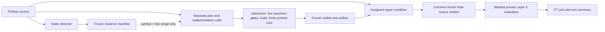

# Generated-Test Factorial Runbook

Status: pre-freeze pilot and campaign runbook  
Companion protocol: `docs/TEST_FEEDBACK_PROTOCOL.md`

The manifest-driven blocked runner is implemented. Keep using non-evaluation
fixtures until the remaining recorded freeze gates in the protocol are filled.
The eight individual arm commands remain useful for plumbing pilots only; the
final corpus experiment must use `factorial-manifest` followed by
`factorial-campaign`.



## 1. Isolate a pilot directory

Run the CLI from a fresh directory so its `runs` outputs cannot mix with prior
or evaluation data. The examples use PowerShell and absolute paths.

```powershell
$repo = 'Z:\GitHub\hybrid-static-llm-pipeline'
$cli = "$repo\src\HybridLens.CLI\HybridLens.CLI.csproj"
$pilot = 'Z:\HybridLensCampaigns\generated-test-pilot'
$target = 'Z:\path\to\non-evaluation-fixture\Fixture.sln'
$baseline = 'Z:\path\to\non-evaluation-fixture\analyser.jsonl'
New-Item -ItemType Directory -Force $pilot | Out-Null
Set-Location $pilot
```

Use a non-corpus fixture during development. Private corpus outcomes must not be
inspected while prompts, limits, or runners can still change.

## 2. Verify implementation and frozen oracle

```powershell
dotnet test "$repo\src\HybridLens.Tests\HybridLens.Tests.csproj" --nologo
```

The suite includes a hash check against
`layer3/PRIVATE_ORACLE_MANIFEST.md`. Any mismatch is a stop condition.

## 3. Generate visible tests before repair

Invoke the generator once for every distinct Long Method/God Class source file.
Each invocation contains a planning call and an implementation call. A single
diagnostics-only correction is made only when the implemented suite does not
compile. All artefacts, including rejected admissions, are retained.

```powershell
dotnet run --project $cli -- generate-characterization-test `
  --from $baseline `
  --target $target `
  --source 'Z:\path\to\non-evaluation-fixture\Proj\Example.cs' `
  --model '<frozen-model-key>' `
  --out "$pilot\generated-tests" `
  --baseline-runs 3 `
  --timeout 180
```

The CLI reads the frozen analyzer JSONL only in the experiment controller. It
requires exactly one included Long Method/God Class instance for `--source` and
places only its symbol and declaration line range in the test-authoring prompt.
The prompt also contains the neutral public surface of project-local types named
by that source file. It never places the anti-pattern label, severity, metrics, thresholds, finding
text, reference repair, or private oracle in that prompt.

## 4. Pilot the eight cells

Use the same model, source, repetitions, and timeouts in every applicable cell.
Supplying `--visible-tests` means assignment to the test-enabled condition; a
missing or rejected artifact remains an unavailable test inside that arm.

```powershell
# Independent single-shot: ungrounded, tests off/on
dotnet run --project $cli -- factorial-single-shot --from $baseline --target $target --model '<frozen-model-key>' --runs 1 --build-timeout 180
dotnet run --project $cli -- factorial-single-shot --from $baseline --target $target --model '<frozen-model-key>' --runs 1 --build-timeout 180 --visible-tests "$pilot\generated-tests"

# Independent single-shot: grounded, tests off/on
dotnet run --project $cli -- factorial-single-shot --from $baseline --target $target --model '<frozen-model-key>' --runs 1 --build-timeout 180 --grounded
dotnet run --project $cli -- factorial-single-shot --from $baseline --target $target --model '<frozen-model-key>' --runs 1 --build-timeout 180 --grounded --visible-tests "$pilot\generated-tests"

# Iterative: ungrounded, tests off/on
dotnet run --project $cli -- agentic --from $baseline --target $target --model '<frozen-model-key>' --runs 1 --budget 6 --build-timeout 180
dotnet run --project $cli -- agentic --from $baseline --target $target --model '<frozen-model-key>' --runs 1 --budget 6 --build-timeout 180 --visible-tests "$pilot\generated-tests"

# Iterative: grounded, tests off/on
dotnet run --project $cli -- grounded-iterative --from $baseline --target $target --model '<frozen-model-key>' --runs 1 --budget 6 --build-timeout 180
dotnet run --project $cli -- grounded-iterative --from $baseline --target $target --model '<frozen-model-key>' --runs 1 --budget 6 --build-timeout 180 --visible-tests "$pilot\generated-tests"
```

For the final campaign, use the frozen manifest-driven schedule below. Do not
execute the eight commands above as eight long sequential batches.

## 5. Freeze and execute the randomized campaign

Commit the final implementation first, record that revision, then create the
manifest. Manifest creation verifies the baseline, source revisions, admitted
test hashes, prompt versions, budgets, and the complete set of eight conditions
per instance × repetition block.

```powershell
$manifest = "$pilot\factorial-manifest.json"
$campaign = "$pilot\campaign"

dotnet run --project $cli -- factorial-manifest `
  --from $baseline `
  --target $target `
  --visible-tests "$pilot\generated-tests" `
  --model '<frozen-model-key>' `
  --code-revision '<frozen-commit-sha>' `
  --runs 3 `
  --budget 6 `
  --build-timeout 180 `
  --max-input-tokens 120000 `
  --seed '<fixed-integer-seed>' `
  --out $manifest

dotnet run --project $cli -- factorial-campaign `
  --manifest $manifest `
  --out $campaign
```

The runner preflights all frozen files before its first model call, follows the
manifest order, writes one trace per assignment, and appends a completion ledger.
Re-running the same command safely skips completed assignments. An uncommitted
partial trace is a stop condition and must be quarantined and documented rather
than silently overwritten.

## 6. Freeze repair outputs before private evaluation

Confirm that each attempted cell produced a JSONL trace and that each
materialized final state has a `*-final-sources` artifact. Hash and archive the
entire campaign directory. From this point onward, do not change prompts,
budgets, source artefacts, or admission decisions.

## 7. Run private Layer 3 only after all repair cells terminate

Create one new result file per final-source directory. The command refuses to
overwrite an existing result, verifies every frozen oracle hash, makes no model
call, gives no feedback, and performs no retry.

```powershell
$privateOut = "$pilot\private-results"
New-Item -ItemType Directory -Force $privateOut | Out-Null
dotnet run --project $cli -- private-layer3 `
  --artifacts "$campaign\final-sources" `
  --target $target `
  --oracle-manifest "$repo\layer3\PRIVATE_ORACLE_MANIFEST.md" `
  --out "$privateOut\layer3-campaign.jsonl" `
  --timeout 180
if ($LASTEXITCODE -ne 0) { throw "Private Layer-3 evaluation failed" }
```

## 8. Produce the ITT and cost tables

```powershell
dotnet run --project $cli -- factorial-summary `
  --runs-dir "$campaign\traces" `
  --private-dir "$privateOut" `
  --out "$pilot\results"
```

The output contains:

- `attempts.json`: one final Long Method/God Class attempt per assigned cell;
- `arm_summary.json`: effectiveness and resource use by factorial arm;
- `arm_summary.csv`: the same arm tracker for R, Python, or spreadsheet use.

The analyzer excludes Obsolete API, detection rows, and iterative first-build
snapshots; retains unmaterialized attempts in the ITT denominator; requires a
private result for every materialized state; and computes:

`strict_success = build_passed AND metric_resolved AND private_test_passed`

Report the primary paired risk-difference figure only after the full frozen
campaign. A compact secondary panel should show the corresponding difference in
mean total repair tokens; the arm CSV also retains calls, build attempts, test
attempts, test time, and repair wall time.
